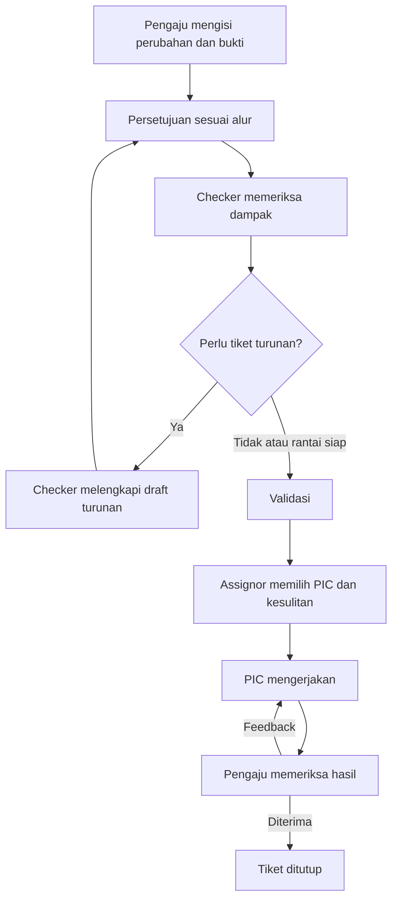

//CTRL+SHIFT+V
# BRD — Ticketing Support

| Informasi | Keterangan |
| --- | --- |
| Aplikasi | `hrd_apps_server` |
| Versi / tanggal | 1.0 / 1 Oktober 2026 |
| Status | Baseline implementasi untuk tinjauan bisnis; belum merupakan persetujuan UAT/rilis |
| Ruang lingkup | Ticketing Support: perubahan transaksi dan pendaftaran vendor |
| Dokumen terkait | [PRD](PRD.md), [FRD](FRD.md), [Milestone](MILESTONE.md) |

## 1. Dasar penyusunan

Dokumen disusun setelah memeriksa route, controller, service, model, view, serta migration/seeder terkait. BRD, PRD, dan FRD awal kosong. Lingkup dokumentasi khusus Ticketing Support, bukan seluruh modul HRD seperti absensi, cuti, payroll, atau project management.

Istilah **tersedia di kode** berarti ditemukan implementasi yang dapat ditelusuri; tidak menyatakan fungsi sudah lulus pengujian operasional. Pemeriksaan tidak mencakup data produksi, pengiriman email, pengujian browser, atau persetujuan pemilik proses. Kebutuhan bisnis di bawah dirumuskan dari kemampuan aplikasi; target manfaat dan pemilik proses masih perlu disahkan organisasi.

## 2. Latar belakang dan tujuan

Ticketing Support menyediakan pencatatan permintaan perubahan transaksi yang membutuhkan persetujuan, pemeriksaan dampak terhadap transaksi terkait, validasi, dan pelaksanaan oleh PIC. Aplikasi menyimpan informasi sebelum/sesudah perubahan, alasan, lampiran, tanda tangan, serta riwayat tindakan agar pekerjaan dapat ditelusuri.

Permintaan dapat melibatkan beberapa modul atau lingkungan aplikasi. Aturan dependensi membentuk tiket lanjutan yang memiliki referensi ke tiket asal. Pendaftaran vendor menggunakan formulir dan alur approval tersendiri dalam area Ticketing Support.

Tujuan bisnis:

1. Menyatukan permintaan dan bukti pendukung dalam catatan yang dapat diperiksa.
2. Memperjelas pihak yang menyetujui, memeriksa, memvalidasi, dan melaksanakan pekerjaan.
3. Menelusuri hubungan perubahan antartransaksi dan antarlingkungan aplikasi.
4. Memisahkan pekerjaan selesai oleh PIC dari penerimaan hasil oleh pengaju.
5. Menyediakan informasi beban kerja, durasi, revisi, dan pencapaian target layanan.

## 3. Pemangku kepentingan

| Peran | Kebutuhan / tanggung jawab |
| --- | --- |
| Pengaju / requestor | Mengisi permintaan, melihat kemajuan, memberi feedback, menutup tiket setelah menerima hasil |
| Atasan / approver | Menyetujui atau menolak sesuai konfigurasi alur |
| Checker | Memeriksa kondisi/dampak perubahan, membuat dan melengkapi tiket turunan |
| Validator | Memastikan tiket atau kelompok tiket siap diteruskan ke penugasan |
| Assignor | Menetapkan PIC dan tingkat kesulitan; melakukan penugasan ulang |
| PIC | Melaksanakan pekerjaan, mencatat jeda/hasil, menindaklanjuti feedback |
| Administrator | Mengelola master layanan, hub, approval, dependency, validator, assignment, dan target |
| Pemantau layanan / manajemen | Membaca laporan, status, dan KPI untuk evaluasi |
| Pemilik proses vendor | Meninjau data usaha, perpajakan, pembayaran, dan konfigurasi sistem vendor |

Nama sponsor, penanggung jawab, dan pejabat penerima dokumen belum ditetapkan pada baseline ini.

## 4. Kebutuhan dan lingkup bisnis

| ID | Kebutuhan bisnis | Dukungan implementasi | PRD |
| --- | --- | --- | --- |
| BR-01 | Mengatur layanan dan pihak terkait | Master menu/submenu, hub, kondisi, approval, validator, assignment, difficulty, canvas | PR-01 |
| BR-02 | Mencatat perubahan beserta bukti | Detail/subdetail transaksi, sebelum/sesudah, alasan, lampiran, tanda tangan | PR-02 |
| BR-03 | Mengendalikan persetujuan dan pemeriksaan | Approver 1/2, checker, komentar, signature, preview approval | PR-03 |
| BR-04 | Menangani perubahan berantai | Dependency, generated draft, forward/reverse, lintas lingkungan, pembatalan draft turunan | PR-04 |
| BR-05 | Memastikan kesiapan sebelum penugasan | Validasi individual/kelompok dan pemeriksaan kesiapan rantai | PR-05 |
| BR-06 | Mengatur pelaksana dan pekerjaan | Assignor/PIC, kesulitan, start/finish/pending/resume/cancel | PR-06 |
| BR-07 | Memastikan hasil diterima pengaju | Feedback, sesi revisi, dan close oleh pengaju | PR-07 |
| BR-08 | Menyediakan evaluasi layanan | Laporan, PDF tiket, dashboard KPI admin/PIC, sesi kerja | PR-08 |
| BR-09 | Menginformasikan tindakan berikutnya | Email sesuai tahap dan catatan aktivitas | PR-09 |
| BR-10 | Mengelola pengajuan vendor | Form Epicor/Accurate, dokumen pendukung, approval bertahap | PR-10 |

Lingkungan tiket perubahan pada UI: `1 = Epicor ERP`, `2 = Accurate Online SP`, `3 = Accurate Online AJA`. Kode sistem vendor berbeda: `1 = Epicor`, `2 = Accurate`. Pilihan tersebut menunjukkan konteks pengajuan; tidak membuktikan koneksi langsung ke ERP.

Sinkronisasi otomatis perubahan ke ERP, portal vendor eksternal, persetujuan melalui balasan email, eskalasi SLA otomatis, WhatsApp/SMS, dan aplikasi mobile native berada di luar baseline yang terverifikasi. Navigasi pengguna berkategori `mobile` pada kode merupakan bagian antarmuka web yang ditinjau.

## 5. Alur bisnis ringkas

Diagram menunjukkan alur umum. Approval dapat dilewati melalui aturan auto-approval/auto-validation; tahap aktual mengikuti konfigurasi. Tiket lintas lingkungan dapat memulai kelompok baru dengan referensi ke asal. Penolakan/pembatalan menghentikan jalur terkait. FRD menjelaskan pengecualian dan status secara rinci.

## 6. Ukuran manfaat

| Ukuran | Sumber | Ketentuan penggunaan |
| --- | --- | --- |
| Volume, tiket aktif, selesai, dibatalkan | Status dan laporan | Definisi filter/periode harus disamakan antar-dashboard |
| Durasi kerja PIC | Sesi kerja tertutup | Review pengaju dan jeda eksternal tidak dimasukkan dalam sesi kerja normal |
| Penyelesaian sesuai target | Aktual dibanding target kesulitan | Satuan KPI harus direkonsiliasi sebelum menjadi komitmen layanan |
| Jumlah revisi | `feedback_cycles` | Mengukur feedback pengaju, bukan seluruh pergantian sesi |
| Ketertelusuran proses | Rantai, komentar, signature, activity log | Kelengkapan tiap jalur perlu dibuktikan dalam UAT |

Nilai awal, target persentase, SLA resmi, dan periode pelaporan bisnis belum disepakati. Nilai default seeder tidak otomatis menjadi SLA perusahaan.

## 7. Ketergantungan dan batasan

- Akun pengguna terhubung dengan data karyawan dan struktur organisasi yang relevan.
- Master approval, checker, validator, assignment, dan akses hub harus benar.
- Database, penyimpanan lampiran/signature, mailer, serta worker antrean perlu siap pada lingkungan tujuan.
- Migration pembentukan sebagian tabel inti Ticketing belum ditemukan pada direktori migration yang ditinjau; instalasi baru perlu dicocokkan dengan skema aktual.
- Temuan kode pada validasi individual, edit draft, feedback kosong, KPI, dan vendor membatasi klaim kesiapan operasional. Rincian ada di [FRD bagian 10](FRD.md#10-temuan-dan-batasan-baseline).

## 8. Penerimaan bisnis

Penerimaan memerlukan persetujuan pemilik proses atas cakupan/peran, kelulusan skenario PRD, penutupan temuan penghambat, serta bukti operasi email, penyimpanan, dan laporan. Persetujuan bisnis dan keputusan rilis dicatat pada [Milestone](MILESTONE.md); keduanya belum dinyatakan selesai pada peninjauan ini.

## 9. Sumber penelusuran

- [Route pengguna](../../routes/Users.php) dan [route admin](../../routes/web.php).
- [TicketController](../../app/Http/Controllers/TicketController.php), [ApprovalController](../../app/Http/Controllers/ApprovalController.php), [TicketWebController](../../app/Http/Controllers/TicketWebController.php).
- [CheckerService](../../app/Services/CheckerService.php), [TicketChainService](../../app/Services/TicketChainService.php), [TicketKpiService](../../app/Services/TicketKpiService.php).
- [View pengguna](../../resources/views/users/ticket) dan [view admin](../../resources/views/admin/ticket).
